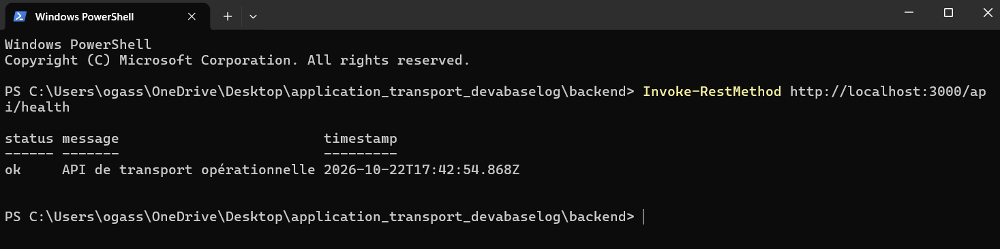

# Test de l'API Node.js

## 1. Informations

- Date du test documenté : 22/10/2026
- Responsable : Oussema Gassara
- Système utilisé : Windows
- Version de Node.js indiquée lors du test : v26.5.1
- Version de npm indiquée lors du test : 11.17.0
- Serveur : Node.js avec Express
- Port : 3000

## 2. Objectif

Vérifier que le serveur Node.js démarre correctement et que l'API répond à une requête HTTP.

## 3. Endpoint testé

| Élément | Valeur |
|---|---|
| Méthode | GET |
| URL | `http://localhost:3000/api/health` |
| Résultat attendu | HTTP 200 |
| Format de réponse | JSON |

## 4. Démarrage du serveur

Depuis le dossier du projet :

```powershell
cd backend
npm install
npm run dev
```

Le serveur indique qu'il écoute sur `http://localhost:3000`.

## 5. Exécution du test

Dans un autre terminal PowerShell, exécuter :

```powershell
Invoke-RestMethod http://localhost:3000/api/health
```

Pour vérifier explicitement le code HTTP et lire le contenu JSON :

```powershell
$response = Invoke-WebRequest -Uri "http://localhost:3000/api/health"
$response.StatusCode
$response.Content | ConvertFrom-Json
```

## 6. Résultat attendu et résultat documenté

Le test documenté dans le Sprint 1 indique une réponse HTTP 200 avec un objet JSON contenant :

```json
{
  "status": "ok",
  "message": "API de transport opérationnelle",
  "timestamp": "<date et heure générées au moment de la requête>"
}
```

Le champ `timestamp` est généré dynamiquement par le serveur ; sa valeur change à chaque requête.

## 7. Preuve

La capture du test réalisée avec PowerShell est disponible ici :



## 8. Conclusion

Le test de la route `GET /api/health` est documenté comme réussi : l'API retourne une réponse HTTP 200 au format JSON. Cette route sert à vérifier que le serveur Node.js/Express est opérationnel. Elle ne représente pas encore une fonctionnalité métier de réservation.
