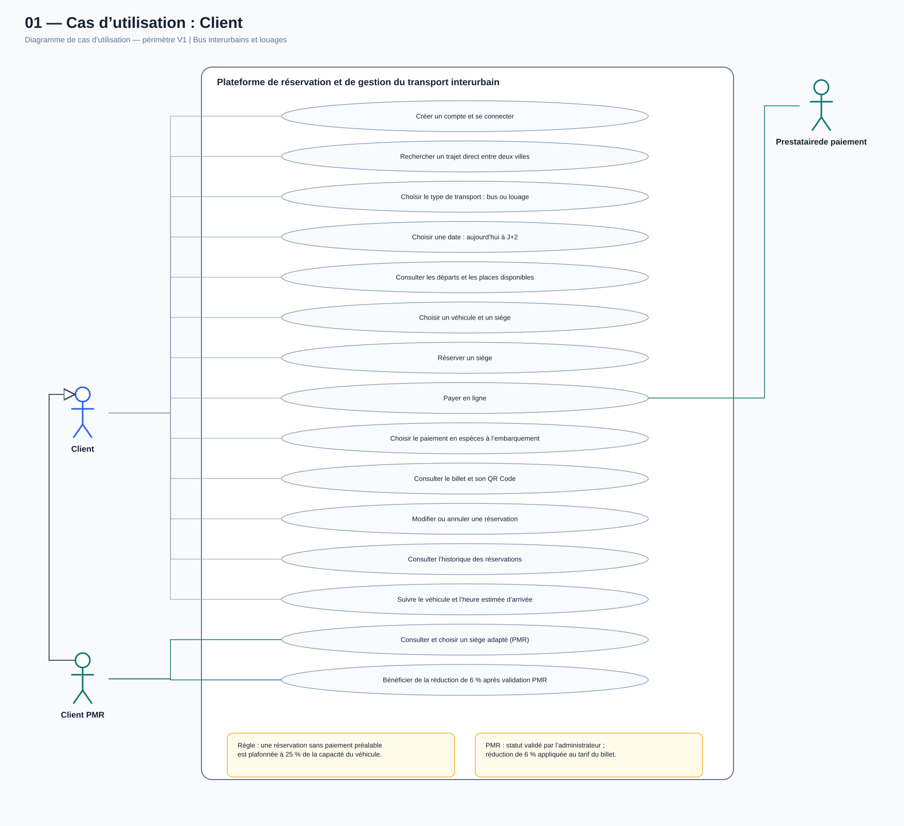
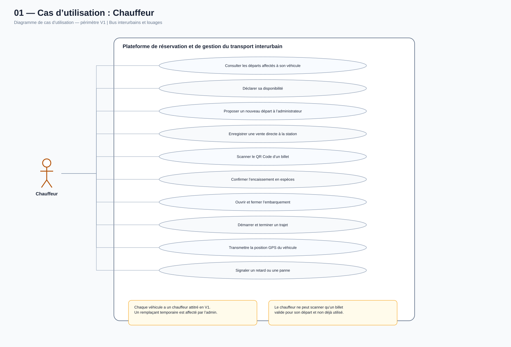
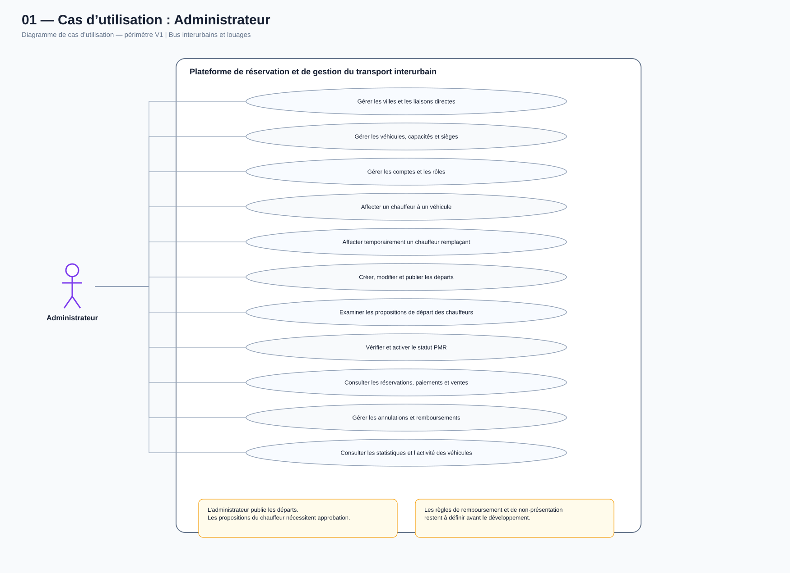

# Conception UML — Application de transport interurbain en Tunisie (V1)

Ce dossier contient les sources PlantUML éditables de la première conception de la V1. Les diagrammes sont des propositions de travail destinées à être relues et validées avant l'implémentation.

## Périmètre fonctionnel retenu

- Bus interurbains et louages.
- Trajets directs entre deux villes, sans réservation par tronçon intermédiaire.
- Recherche par type de transport, ville de départ, destination et date.
- Réservation possible aujourd'hui et jusqu'à J+2.
- Choix du siège pour les bus et les louages.
- Plafond de réservations sans paiement préalable : 25 % de la capacité, par départ.
- Paiement en ligne ou en espèces à l'embarquement.
- Achat direct en espèces à la station, enregistré comme vente distincte.
- Client PMR : statut vérifié par l'administrateur et réduction de 6 % après validation.
- Chauffeur : contrôle QR, confirmation des espèces, gestion de l'embarquement et transmission GPS.
- Administrateur : crée et publie les départs ; le chauffeur peut proposer un départ soumis à approbation.
- Chaque véhicule a un chauffeur attitré en V1 ; remplacement temporaire possible avec validation de l'administrateur et historique.
- Un véhicule peut effectuer plusieurs départs dans la journée si le véhicule et son chauffeur sont disponibles et si les départs ne se chevauchent pas.
- Durée initiale estimée, ETA actualisée et durée réelle conservées séparément.

## Diagrammes

| Fichier | Contenu |
|---|---|
| 01a_cas_utilisation_client.puml | Cas d'utilisation Client et Client PMR |
| 01b_cas_utilisation_chauffeur.puml | Cas d'utilisation Chauffeur |
| 01c_cas_utilisation_administrateur.puml | Cas d'utilisation Administrateur |
| 02_diagramme_classes.puml | Diagramme de classes |
| 03a_sequence_recherche_reservation.puml | Recherche et réservation |
| 03b_sequence_scan_embarquement.puml | Scan QR et embarquement |
| 03c_sequence_vente_directe_station.puml | Achat direct à la station |
| 03d_sequence_gps_eta_duree.puml | GPS, ETA et durée réelle |
| 03e_sequence_creation_depart.puml | Création et publication d'un départ |
| 04_diagramme_deploiement.puml | Déploiement technique |

## Aperçus visuels (SVG)

Les trois diagrammes de cas d'utilisation sont également disponibles en SVG directement visualisables dans GitHub.

### Client et Client PMR

### Chauffeur

### Administrateur

Les autres diagrammes restent disponibles sous forme de sources PlantUML dans ce dossier. Leurs aperçus visuels pourront être ajoutés après la revue des premiers diagrammes.

## Points à valider avant de figer la conception

1. Choix ville uniquement ou sélection explicite des stations de départ et d'arrivée.
2. Durée exacte d'ouverture de l'embarquement et condition de fermeture.
3. Politique d'annulation, de non-présentation et frais/remboursement.
4. Règle d'arrondi du plafond de 25 % (arrondi inférieur proposé).
5. Acteurs autorisés à enregistrer les ventes directes à la station.
6. Mode de remise du QR Code après un achat direct.
7. Prestataire de paiement et prise en charge des remboursements.
8. Fournisseur cartographique/routage et disponibilité des données de trafic.
9. Fréquence GPS, fonctionnement hors ligne et durée de conservation.
10. Temps minimum de préparation entre deux départs.
11. Justificatifs, durée de validité et conservation des éléments de vérification PMR.
12. Procédure de transfert des réservations en cas de panne ou de remplacement de véhicule.

## Hypothèses techniques importantes

- La limite de 25 % s'applique aux réservations PAY_ON_SITE, par départ.
- Une vente directe à la station n'est pas une réservation préalable (WalkInSale) ; elle partage le même inventaire de sièges.
- Les statuts de réservation, de paiement et d'embarquement sont distincts.
- Le QR Code est un jeton unique, vérifié côté serveur et utilisable une seule fois.
- Un siège ne peut pas être attribué deux fois pour un même départ.
- Le GPS est transmis par le téléphone du chauffeur pendant un trajet actif, après autorisation de géolocalisation.

Les fichiers .puml peuvent être modifiés avec l'extension PlantUML de VS Code ou un outil compatible PlantUML.

**État :** première version de conception UML publiée pour revue. Les points listés ci-dessus restent ouverts et ne sont pas des spécifications définitivement validées.
